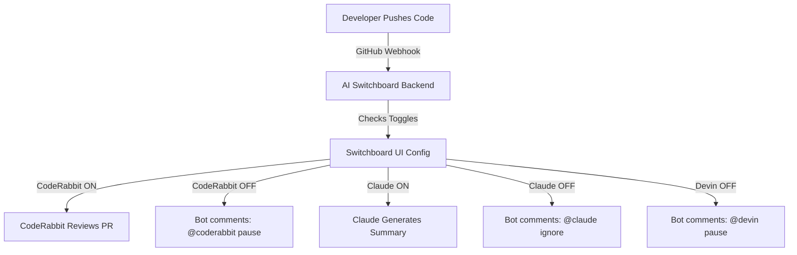
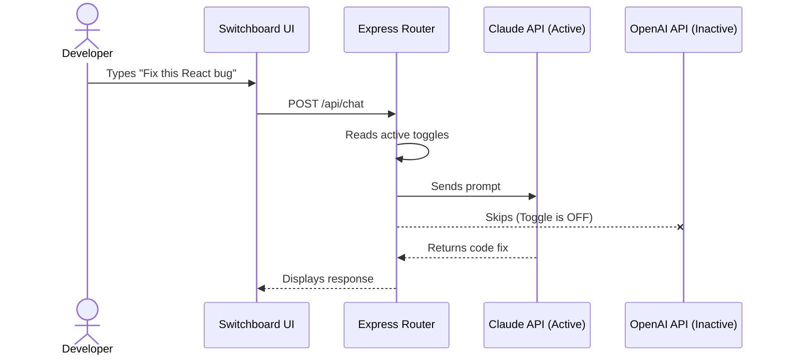

# 🎛️ AI Switchboard

Stop AI bot fatigue. Save API credits. Control the chaos.

## The Problem
Modern developers connect multiple AI assistants to the same repository: CodeRabbit, Devin, Cursor, Claude, and OpenAI. When a PR opens or a push lands, they all wake up at once. That means duplicate reviews, wasted API tokens, and an obvious slowdown on local machines.

## The Solution
AI Switchboard is a traffic cop for your AI stack. It sits in front of the tools you use and lets you switch each one on or off from a single dashboard. When a bot is off, the switchboard can auto-comment on a PR or skip the route entirely so the rest of your stack keeps moving without wasting time or tokens.

## Features
- Dark-mode dashboard inspired by an old telephone switchboard
- Per-tool toggles for CodeRabbit, Devin, Claude, OpenAI, and Cursor
- GitHub webhook integration for `pull_request` and `push` events
- Unified chat route that sends prompts to the active tools only
- JSON-based settings persistence and local configuration management

## Architecture





## Local Setup

1. Clone the repository.
2. Install workspace dependencies:
   ```bash
   npm install
   ```
3. Copy `.env.example` to `.env` and set your keys.
4. Start the app:
   ```bash
   npm run dev
   ```
5. Open the frontend in the browser at `http://localhost:5173`.

## Backend API

The backend exposes:
- `GET /api/config` - fetch active bot toggles
- `POST /api/config` - update a toggle value
- `POST /api/chat` - send a prompt to the active AI tools only
- `POST /api/github/webhook` - verify GitHub webhook signatures and handle events

## How it Works

1. The dashboard stores state in a local JSON file under `backend/data/switchboard-settings.json`.
2. GitHub webhooks are verified using `@octokit/webhooks` and `x-hub-signature-256`.
3. The chat route reads the current settings and only calls the enabled services.
4. If a bot is disabled, the system can respond with a relevant mute message instead of sending traffic to it.

## Support

AI Switchboard is free and open-source. If it saves you from wasting API credits, review noise, or bot fatigue, support the project with a tip or share it with another developer.

- GitHub Sponsors: `https://github.com/sponsors/rahmaanherman-source`
- Buy Me a Coffee: `https://www.buymeacoffee.com/rahmaanherman`

If you cannot contribute financially, the best support is sharing the project, filing issues, or improving the toggle logic.
