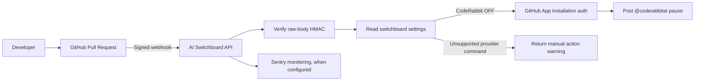

# 🎛️ AI Switchboard

**Stop AI bot fatigue. Control the chaos. See what actually happened.**

AI Switchboard is a GitHub-focused control plane for AI development tools. Its backend can verify GitHub webhook signatures, inspect configured tool toggles, and issue a documented CodeRabbit pause command when CodeRabbit is switched off.

> **Release truth:** the backend scaffold is not the same as a deployed, connected product. Real PR comments require a configured GitHub App installed on the target repository with the required permissions. Sentry requires a DSN. Missing configuration is reported as not configured; it is never presented as operational.

## Current backend capabilities

- HMAC verification against the original raw GitHub webhook body (x-hub-signature-256).
- PR opened and reopened event handling.
- GitHub App installation authentication for authorized comment actions.
- CodeRabbit pause comment (@coderabbitai pause) when its toggle is off; duplicate pause comments are checked before posting.
- Explicit manual-action warnings for Devin and Claude rather than invented bot commands.
- Optional Sentry error/exception monitoring with PII collection disabled by default.
- CORS restricted to the configured frontend origin.
- Existing local JSON settings and AI chat routes remain in place.

## Architecture



## Local setup

1. Install Node.js 20 or newer.
2. Install workspace dependencies from the repository root:

   ```bash
   npm install
   ```

3. Copy .env.example to .env and set only the credentials you have configured.
4. Start both workspaces:

   ```bash
   npm run dev
   ```

5. Backend health check: http://localhost:4000/api/health. Frontend dev server: http://localhost:5173.

## Configure GitHub webhook delivery

1. Create a GitHub App under Settings → Developer settings → GitHub Apps.
2. Set a webhook URL pointing to your deployed backend at /api/github/webhooks.
3. Set a strong webhook secret and put the same value in GITHUB_WEBHOOK_SECRET.
4. Subscribe to Pull request events.
5. Grant only the permissions required for your deployment. Posting a PR comment requires Issues: Read and write; read repository metadata as needed.
6. Install the App on the repositories it should control.
7. Set GITHUB_APP_ID and GITHUB_PRIVATE_KEY in the server environment. Never commit actual credentials.
8. Configure the same Sentry project DSN in SENTRY_DSN to enable exception monitoring.

The webhook handler rejects missing or invalid signatures. It verifies the raw request body before parsing JSON. The route must remain registered before global express.json() middleware.

## Environment variables

| Variable | Purpose |
|---|---|
| GITHUB_WEBHOOK_SECRET | Validates GitHub webhook signatures |
| GITHUB_APP_ID | Identifies the GitHub App |
| GITHUB_PRIVATE_KEY | Signs GitHub App authentication requests |
| SENTRY_DSN | Enables Sentry monitoring; blank means not configured |
| SENTRY_ENVIRONMENT | Environment label sent to Sentry |
| SENTRY_TRACES_SAMPLE_RATE | Performance tracing sample rate |
| FRONTEND_ORIGIN | Allowed browser origin for API calls |
| OPENAI_API_KEY | Optional OpenAI route credential |
| ANTHROPIC_API_KEY | Optional Anthropic route credential |

## Bot-muting limits

- **CodeRabbit:** the handler can post @coderabbitai pause on an opened/reopened PR when its toggle is off.
- **Devin:** no PR-comment mute command is assumed. Disable bot responses in Devin's own settings; the API reports this as a manual action.
- **Claude:** no provider-specific PR mute command is configured here. The API reports this instead of posting a made-up command.
- **Other AI providers:** disabling a Switchboard chat route only prevents this backend from routing prompts to that provider. It does not turn off an external product's independent GitHub bot.

The current implementation checks existing comments before posting CodeRabbit's pause command. For production-scale delivery, add persistent webhook-delivery idempotency storage and a durable audit log before claiming exactly-once processing.

## API

- GET /api/health — backend health and Sentry configuration status.
- GET /api/config — current tool toggles.
- POST /api/config — update tool toggles.
- POST /api/chat — route prompts to configured active AI services.
- POST /api/github/webhooks — verify and process GitHub webhook deliveries.

## Monitoring and privacy

Sentry initializes only when SENTRY_DSN is present. sendDefaultPii is disabled. Review Sentry's data scrubbing and retention settings before production use. Never put API keys, private keys, webhook secrets, or full sensitive prompts into logs.

## Not yet verified

These repository changes have not, by themselves, installed dependencies, run TypeScript builds, configured a GitHub App, configured Sentry, or tested a live webhook against a real repository. Treat those as UNVERIFIED until run with the required environment and permissions.

## Support

AI Switchboard is free and open-source. Share feedback or file issues to help improve the project.
